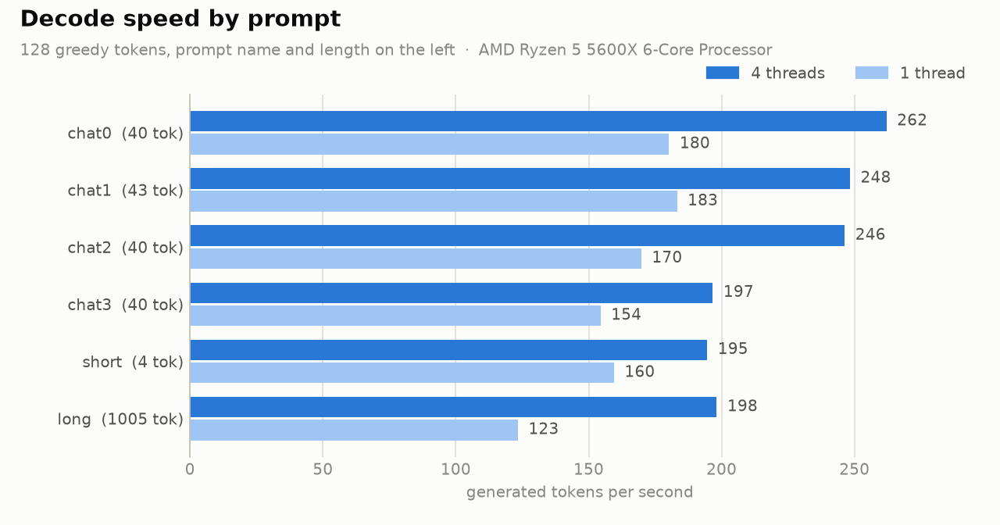
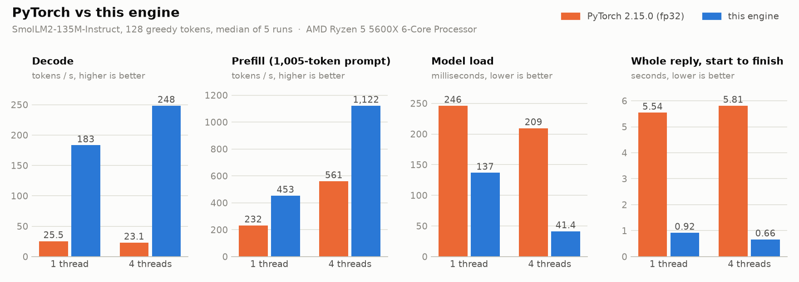

# SmolLM2-135M-Instruct CPU engine

Yet another slop vibe coded engine! Written in Rust, overnight.

Even this description has been written by an AI (at least partially).

I don't even know what the code does!

<picture>
  <source media="(prefers-color-scheme: dark)" srcset="docs/bench-dark.png">
  
</picture>

<picture>
  <source media="(prefers-color-scheme: dark)" srcset="docs/torch-vs-smol-dark.png">
  
</picture>

## What it is (according to the AI)

A from-scratch CPU inference engine for SmolLM2-135M-Instruct in Rust (std plus `tokenizers`, `half`,
`safetensors`, `gemm`). Weights are read from the model directory on every run; nothing is cached.

## The numbers

Measured on a Ryzen 5 5600X under WSL2, 128 greedy tokens per run, median of 5 runs, against PyTorch 2.15
(CPU build, fp32, `transformers` with a key/value cache) on the same prompts.

| Chat prompt, 43 tokens | PyTorch, 1 thread | Engine, 1 thread | PyTorch, 4 threads | Engine, 4 threads |
|---|---:|---:|---:|---:|
| Decode, tokens/s | 25.5 | 183 | 23.1 | 248 |
| Model load, ms | 246 | 137 | 209 | 41 |
| Whole reply, s | 5.54 | 0.92 | 5.81 | 0.66 |
| Prefill of a 1,005-token prompt, tokens/s | 232 | 453 | 561 | 1,122 |

The comparison is as arbitrary as promised:

- PyTorch runs the weights in fp32 and the engine runs them quantised, so the two do different work. On the
  first 1,024 tokens of `data/dev.u32` the engine's perplexity is 11.10 against PyTorch's 11.08, its top
  token is the same at 98.4% of positions, and the mean KL divergence is 0.0007.
- Greedy replies drift apart all the same: on the chat prompt the two agree for the first 5 tokens and then
  write different (both sensible) text.
- PyTorch's load time counts `from_pretrained` and the tokenizer but not `import torch`, which takes longer
  than the engine's whole reply.
- Use `SMOL_NT=3` or `SMOL_NT=4`. The default is one thread per logical core, and on this 6-core machine
  that decoded slower than a single thread (about 120 against 180 tokens/s).

To measure it yourself (needs `torch`, `transformers`, `tokenizers` and `matplotlib`; results go to
`bench/results.json`, charts to `docs/`):

```bash
python bench/bench.py --smol target/release/smol --model model
```

```bash
python bench/plot.py
```

## Try it in a browser

```bash
./run.sh
```

then open <http://127.0.0.1:8000/>. The script checks the CPU (AVX2, FMA, F16C), downloads
`model.safetensors`, `tokenizer.json` and `config.json` from
[HuggingFaceTB/SmolLM2-135M-Instruct](https://huggingface.co/HuggingFaceTB/SmolLM2-135M-Instruct)
into `./model` (about 270 MB, skipped when already there), builds with `cargo build --release`, and starts
`smol-ui`, a std-only web server (`src/bin/smol-ui.rs`, page in `ui/index.html`).

Settings by environment variable: `PORT`, `HOST` (default `127.0.0.1`; the page has no login), `MODEL_DIR`,
`HF_REPO`, `HF_ENDPOINT`, `HF_TOKEN`. Needs Linux x86-64 and a Rust toolchain; on Windows use WSL.

Every message is one `smol gen --stop` run (the engine stops by itself at the end-of-turn token), so a reply
costs 0.04 to 0.14 s of model and tokenizer loading plus generation at roughly 180 tokens per second on one
core and 250 on four.

Under each reply the page prints its speed: prompt tokens and prefill tok/s, reply tokens and decode tok/s,
model load time, total time (and how many engine runs it took), and the end-to-end rate (reply tokens over total
time). The numbers come from `SMOL_STATS=1`, which makes `smol gen` print one line of per-phase timings on
stderr; the server sets it and sends the result in an `X-Stats` response header.

## Command line

```bash
cargo build --release
target/release/smol gen --model model --prompt-file prompt.txt --chat --n 128
target/release/smol ppl --model model --tokens in.u32 --ctx 1024 --logits out.f32
```

`gen` writes greedy tokens (ties to the lowest id); `--logits` and `--tokens-out` do not change the tokens.
`--stop` ends the reply at the first end-of-turn or end-of-text token. `SMOL_NT=1` runs on one core, and
`SMOL_NT=4` on four.

## What a single query pays for

- Loading: the weight file is mapped (not copied) and quantised on the fly; the low-byte plane is transposed
  16 rows at a time, skipped for the matrix that never uses it, and made row by row on first use for the head.
  The tokenizer loads on its own thread meanwhile.
- Decoding is bound by memory bandwidth (every token streams all the weights once), so the output head, a
  fifth of those bytes, is read at 4 bits per weight when only the greedy token is wanted: that first pass
  brackets every logit, and the few hundred rows that can still win are then computed exactly as before.
  `--logits` and `ppl` always use the full head; `SMOL_HEAD=full` forces it for `gen` too.
